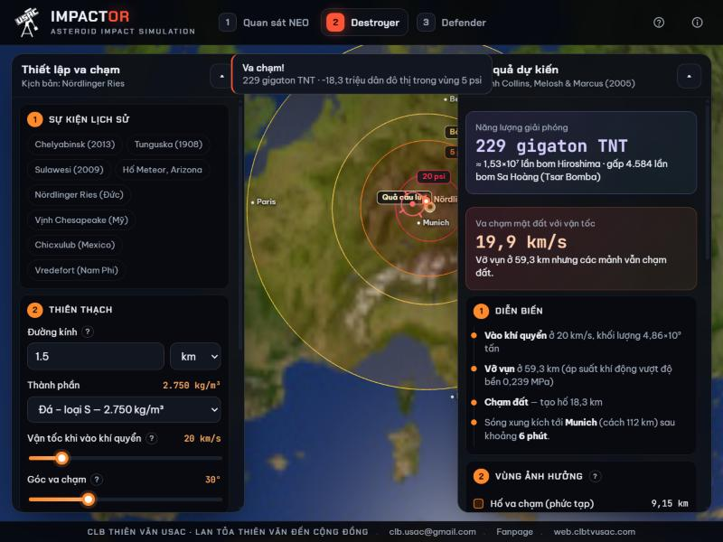
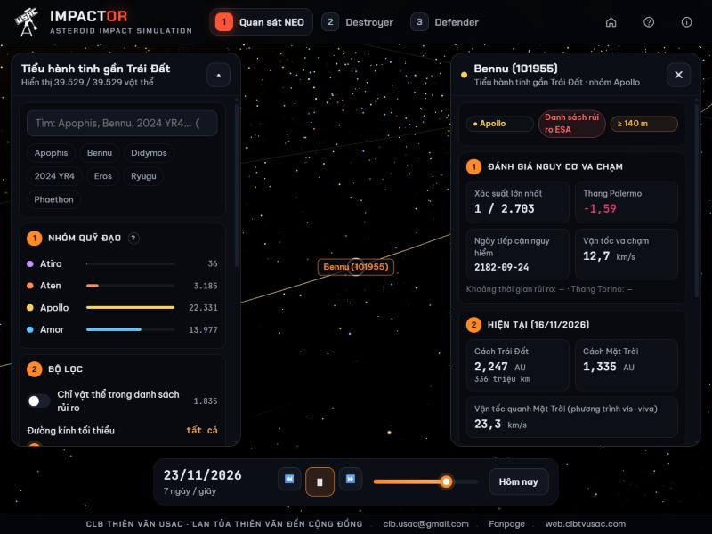
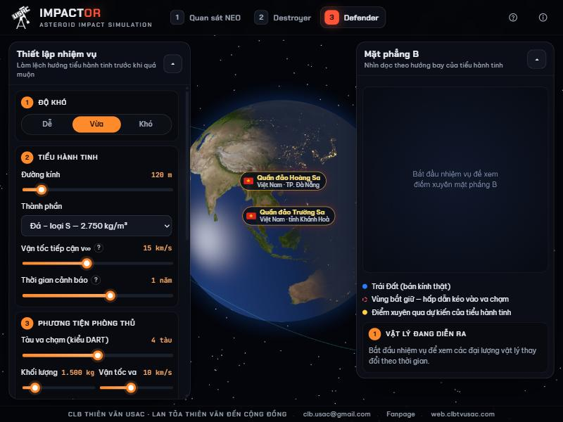

<div align="center">



# IMPACTOR

**ASTEROID IMPACT SIMULATION**

**Mô phỏng tương tác về thiên thể gần Trái Đất, va chạm và phòng thủ hành tinh**

Quan sát gần 40.000 tiểu hành tinh có thật đang bay quanh Mặt Trời, tự tay “thả” một thiên thạch xuống bất kỳ đâu trên Trái Đất, rồi đổi vai để tìm cách đẩy nó đi chệch quỹ đạo trước khi quá muộn.

[](https://astroimpactorlab.clbtvusac.com)

[](LICENSE)




</div>

## Giới thiệu

Trong lịch sử Trái Đất, những vụ va chạm với các thiên thể ngoài không gian đã để lại dấu ấn sâu sắc lên bề mặt hành tinh và góp phần định hình lịch sử tiến hóa của sự sống. Nhưng điều gì thực sự quyết định mức độ tàn phá của một vụ va chạm? Và liệu con người có thể chủ động ngăn chặn một thảm họa như vậy?

**IMPACTOR** do **Nhóm Dự án Giáo dục Thiên văn và Khoa học Thực nghiệm, CLB Thiên văn USAC** (Trường ĐH Khoa học Tự nhiên – ĐHQG-HCM) phát triển, để đưa các vấn đề về thiên thể gần Trái Đất, động lực học va chạm và phòng thủ hành tinh trở thành một trải nghiệm mô phỏng mà người học có thể trực tiếp tham gia. Đây là một trang web tĩnh: không cần cài đặt, không cần đăng nhập, mở trình duyệt là dùng được.

Thông qua hai vai trò đối lập, người chơi tiếp cận bài toán va chạm từ hai góc nhìn:

1. **Quan sát NEO.** Những thiên thể nào được xem là gần Trái Đất? Quỹ đạo của chúng được xác định ra sao, và vì sao một số cần được theo dõi đặc biệt?
2. **Destroyer – kiến tạo kịch bản va chạm.** Kích thước, khối lượng riêng, vận tốc và góc va chạm quyết định hậu quả thế nào? Vì sao một thiên thể 20 m nổ tung trên không, còn một thiên thể 10 km khoét hố rộng hàng trăm kilomet?
3. **Defender – bảo vệ hành tinh.** Một lực đẩy rất nhỏ, nếu tác dụng đủ sớm, có khiến tiểu hành tinh trượt khỏi Trái Đất? Vì sao thời gian cảnh báo lại quan trọng hơn sức mạnh của vũ khí?

> *Thay vì chỉ đọc về những thảm họa va chạm trong lịch sử, người học có cơ hội trực tiếp khảo sát các điều kiện tạo nên chúng và thử đặt mình vào bài toán bảo vệ hành tinh.*

## Tính năng

| | |
|---|---|
| 🪐 **Hệ Mặt Trời & NEO** | 39.529 tiểu hành tinh từ dữ liệu ESA chuyển động theo phương trình Kepler; 8 hành tinh và Sao Diêm Vương theo lịch JPL. Tua nhanh, tua ngược thời gian; tìm kiếm (Apophis, Bennu, 2024 YR4…); lọc theo nhóm quỹ đạo Atira / Aten / Apollo / Amor, kích thước, danh sách rủi ro ESA; tô màu theo nhóm, kích thước hoặc thang Palermo. |
| ☄️ **Destroyer** | Chọn đường kính, thành phần, vận tốc, góc và vị trí; xem năng lượng, độ cao vỡ vụn / nổ trên không, hố va chạm, quả cầu lửa, bỏng nhiệt, sóng xung kích, động đất, sóng thần. Các vùng ảnh hưởng vẽ **đúng bán kính thật** trên quả địa cầu, kèm số dân đô thị và thành phố trong vùng. 8 sự kiện lịch sử dựng sẵn (Chelyabinsk, Tunguska, Hố Meteor, Chicxulub…). |
| 🛡️ **Defender** | Tàu va chạm động năng kiểu DART và laser bóc tách bề mặt; quỹ đạo bay sượt tích phân số dưới lực hấp dẫn Trái Đất; sơ đồ **mặt phẳng B** cho thấy điểm xuyên của tiểu hành tinh và vùng bắt giữ do hội tụ hấp dẫn. Bảng phân tích trước nhiệm vụ cho biết kịch bản có khả thi. |
| 🔗 **Kết nối ba phần** | Chọn một tiểu hành tinh thật rồi bấm “Nếu va chạm?” hoặc “Làm lệch hướng” để mở Destroyer / Defender với đúng kích thước và vận tốc của nó. Thất bại ở Defender sẽ dẫn sang Destroyer tại đúng điểm rơi. |
| 🇻🇳 **Quả địa cầu Việt Nam** | Luôn hiển thị **Quần đảo Hoàng Sa** (TP. Đà Nẵng) và **Quần đảo Trường Sa** (tỉnh Khánh Hoà) thuộc chủ quyền Việt Nam, cùng các đảo tiêu biểu. Ngày/đêm theo vị trí Mặt Trời thực. |
| 📐 **Minh bạch khoa học** | Mỗi con số có công thức và nguồn; hộp “Phương pháp & công thức” nêu rõ giới hạn của mô hình. 14 bài kiểm thử tự động đối chiếu với sự kiện thật. |
| 📱 **Mọi thiết bị** | Giao diện co giãn cho máy tính và điện thoại; phím tắt `/` `Space` `←` `→` `H` `R` `P` `?`. |

## Hình ảnh

| Quan sát NEO | Defender |
|---|---|
|  |  |

## Khoa học phía sau

**Quỹ đạo.** Vị trí mỗi tiểu hành tinh được tính từ dị thường trung bình $M = M_0 + n(t - t_0)$ bằng cách giải phương trình Kepler $M = E - e\sin E$ (Newton–Raphson, khởi động từ nghiệm khung hình trước), với chuyển động trung bình $n = \sqrt{GM_\odot / a^3}$. Đường kính được ước tính từ cấp sao tuyệt đối: $D = 1329\ \text{km} / \sqrt{p_V} \cdot 10^{-H/5}$.

**Va chạm** (Collins, Melosh & Marcus 2005). Năng lượng $E = \tfrac{\pi}{12}\rho L^3 v^2$. Thiên thạch vỡ khi áp suất khí động vượt độ bền $Y = 10^{2{,}107 + 0{,}0624\sqrt{\rho}}$ Pa; các mảnh lan rộng theo mô hình “bánh kếp”, nếu giãn gấp 7 lần trước khi chạm đất thì **nổ trên không**. Hố tạm thời $D_{tc} = 1{,}161\,(\rho_i/\rho_t)^{1/3} L^{0{,}78} v^{0{,}44} g^{-0{,}22} \sin^{1/3}\theta$, hố lớn hơn 3,2 km sụp thành hố phức tạp. Sóng xung kích, bức xạ nhiệt và động đất theo các công thức tương ứng của bài báo.

**Phòng thủ hành tinh.** Tàu va chạm truyền $\Delta v = \beta m u / M$ (DART đo được $\beta \approx 3{,}6$). Tác dụng $\Delta v$ khi còn thời gian $t$ trước va chạm làm điểm xuyên dịch chuyển $\Delta\zeta \approx k\,\Delta v\, t$ với $k$ tăng từ 1 đến 3 — đẩy 1 cm/s trước 10 năm đã dịch gần 9.500 km. Lực hấp dẫn Trái Đất mở rộng “bia” thành bán kính bắt giữ $b_\oplus = R\sqrt{1 + v_{esc}^2/v_\infty^2}$.

## Độ chính xác

Kết quả được đối chiếu với các sự kiện thật (xem `tests/physics.test.mjs`):

| Sự kiện | Mô phỏng | Thực tế |
|---|---|---|
| Chelyabinsk 2013 (20 m) | nổ ở ~30 km, ~0,6 Mt | ~30 km, ~0,4–0,5 Mt |
| Hố Meteor, Arizona (50 m, sắt) | hố ~1,4 km | ~1,2 km |
| Chicxulub (10 km) | hố ~125 km | ~150–180 km |
| Bennu (ESA) | xác suất 1/2.703, Palermo −1,59 | dữ liệu ESA hiển thị trực tiếp |

Mô hình bỏ qua địa hình, thời tiết, hướng bay (trừ góc) và quỹ đạo nhật tâm trong pha tiếp cận của Defender; số dân chỉ tính từ 11.286 khu đô thị. IMPACTOR là công cụ giáo dục, không phải công cụ dự báo.

## Chạy trên máy

```sh
npm ci
npm run dev      # mở http://localhost:5173
npm test         # 14 bài kiểm thử vật lý
npm run build    # xuất bản tĩnh vào dist/
```

Cập nhật dữ liệu NEO: tải danh mục mới từ ESA NEOCC về `src/data/*.json` rồi chạy `npm run data` (chuyển 14,6 MB JSON thành tệp nhị phân 1,4 MB trong `public/data/`). Giáo viên có thể đổi thời lượng một ván Defender bằng `defense.html?dur=120` (giây).

Mỗi lần đẩy lên nhánh `main`, GitHub Actions chạy kiểm thử, build và xuất bản lên GitHub Pages (`.github/workflows/deploy.yml`).

## Cấu trúc

```
index.html · impact.html · defense.html      ba phần: Quan sát NEO · Destroyer · Defender
src/pages/    solar.js · impact.js · defense.js
src/lib/      orbit.js        cơ học Kepler, lịch hành tinh, phân loại NEO
              impact.js       mô hình hậu quả va chạm (Collins 2005)
              deflection.js   vật lý làm lệch hướng, tích phân quỹ đạo bay sượt
              geo.js          hình học mặt cầu, vị trí Mặt Trời, Hoàng Sa – Trường Sa
              globe.js        quả địa cầu dùng chung · ui.js · about.js · format.js · places.js
src/styles/   theme.css (hệ nhận diện USAC) + CSS từng phần
public/       data/ (NEO nhị phân, rủi ro, dân số) · models/ · og-logo.png · CNAME
tests/        kiểm thử vật lý
scripts/      build-neo-data.mjs
```

## Tài liệu tham khảo

- G. S. Collins, H. J. Melosh, R. A. Marcus (2005). *Earth Impact Effects Program: A Web-based computer program for calculating the regional environmental consequences of a meteoroid impact on Earth.* Meteoritics & Planetary Science 40(6): 817–840.
- E. M. Standish. *Keplerian Elements for Approximate Positions of the Major Planets.* JPL Solar System Dynamics.
- A. F. Cheng et al. (2023). *Momentum transfer from the DART mission kinetic impact on asteroid Dimorphos.* Nature 616: 457–460.
- T. J. Ahrens, A. W. Harris (1992). *Deflection and fragmentation of near-Earth asteroids.* Nature 360: 429–433.
- ESA NEO Coordination Centre — danh mục quỹ đạo và danh sách rủi ro: <https://neo.ssa.esa.int>.

## Bản quyền

© 2026 CLB Thiên văn USAC. Giữ toàn bộ bản quyền — xem [LICENSE](LICENSE). Bạn được tự do dùng IMPACTOR để học tập và giảng dạy, chia sẻ đường dẫn, trích dẫn ngắn kèm ghi công. IMPACTOR phát triển tiếp từ dự án AstroImpactor (NASA Space Apps Challenge 2025, giấy phép MIT); thư viện, dữ liệu và kết cấu của bên thứ ba giữ giấy phép gốc — xem [THIRD-PARTY-NOTICES.md](THIRD-PARTY-NOTICES.md).

<div align="center">

**CLB Thiên văn USAC – Lan tỏa Thiên văn học đến cộng đồng**

[clb.usac@gmail.com](mailto:clb.usac@gmail.com) · [Fanpage](https://www.facebook.com/clbusac) · [web.clbtvusac.com](https://web.clbtvusac.com/)

</div>
